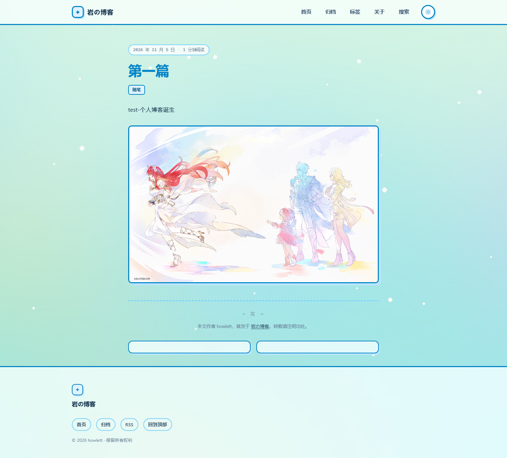
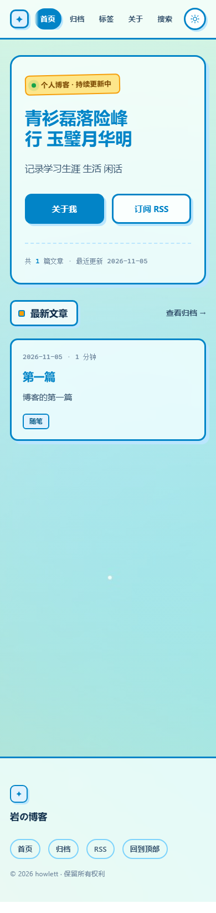
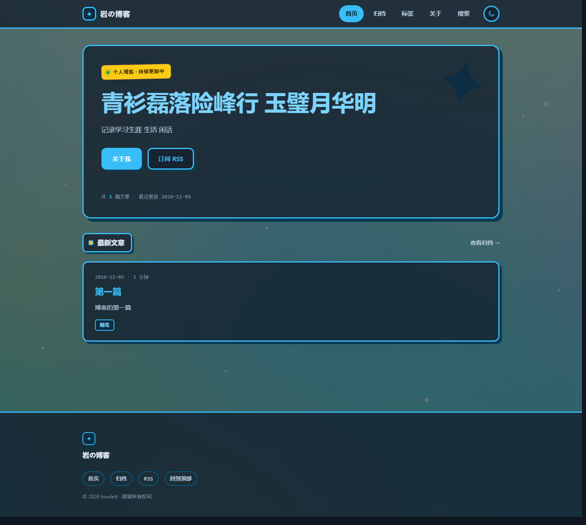
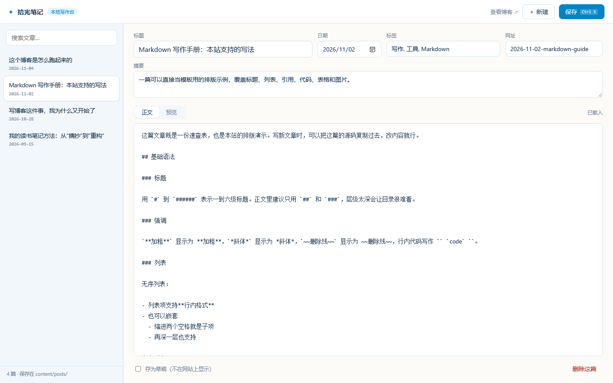

# 拾光笔记 · 一个零依赖的静态博客

一个开箱即用的个人博客模板：**写 Markdown → 一条命令生成网站 → 免费托管上线**。

没有数据库、没有后台、没有 `node_modules`，也不需要服务器。构建器只有几百行 Node 代码，你可以完整读懂它，并按自己的喜好改。

 

## 效果预览

| 首页 | 文章页 |
| --- | --- |
|  |  |

| 移动端 | 暗色模式 |
| --- | --- |
|  |  |

## 它有什么

- **Markdown 写作**：一篇文章一个 `.md` 文件，frontmatter 写标题、日期、标签
- **网页写作后台**：浏览器里填表写文章，保存即生成文件并自动重建（仅本机）
- **自动生成**：首页分页、文章页、归档、标签页、关于页、404、RSS、Sitemap、站内搜索
- **自带设计**：积木粗野主义风格——粗蓝描边、硬投影、贴纸色块，暗色模式、移动端适配、阅读进度条、代码一键复制
- **纯静态**：产物就是 HTML/CSS/JS，任何静态托管都能放
- **可部署**：附带 GitHub Pages 自动发布工作流，也支持 Cloudflare Pages / Netlify

---

## 一、用什么软件编辑

推荐 **VS Code**（微软出品，免费）：<https://code.visualstudio.com/>

它同时能干三件事：改配置（语法高亮、括号配对不会写错）、写文章（Markdown 实时预览）、看效果（内置终端跑预览服务器）。

### 安装

官网下载安装包，一路「下一步」即可。也可以用 winget 一条命令装：

```powershell
winget install Microsoft.VisualStudioCode
```

安装时建议勾选「添加到 PATH」和「将“通过 Code 打开”操作添加到资源管理器目录上下文菜单」，以后在 `D:\博客` 文件夹上右键就能直接打开。

### 打开并开始编辑

1. 打开 VS Code → 菜单「文件 → 打开文件夹」→ 选择 `D:\博客`
2. 左侧文件树里点开要改的文件（`site.config.json`、`theme/texts.mjs`、`content/posts/` 下的文章……）
3. 按 `Ctrl + Shift + B` 启动本地预览（项目已经配好任务，不用敲命令），浏览器访问 <http://localhost:4173>
4. 改完按 `Ctrl + S` 保存，**刷新浏览器**就能看到变化（服务器会自动重建）

写文章时按 `Ctrl + Shift + V`，可以并排预览 Markdown 的排版效果。

### 其他选择

| 软件 | 适合 | 说明 |
| --- | --- | --- |
| **VS Code** | 改文字、改配置、写文章 | 免费，本模板已适配（自带任务和编码设置） |
| Typora | 只写文章 | 所见即所得，写中文体验最好，付费（约 ¥89） |
| Obsidian | 只写文章 | 免费，适合当成长期笔记库 |
| 记事本 | 应急改几个字 | 无高亮无预览，**保存时必须选 UTF-8** |

⚠️ **不要用 Word / WPS 打开** `.md`、`.json`、`.css` 这些文件——它们会塞入格式信息，文件会直接失效。

### 关于编码

项目里所有文件都是 UTF-8。VS Code 默认就是 UTF-8，不用管；用记事本的话，保存时「编码」一栏要选 **UTF-8**。如果改完发现中文变成了「锟斤拷」之类的乱码，就是保存成 ANSI/GBK 了，撤销重存即可。

---

## 二、5 分钟跑起来

前提：安装 [Node.js](https://nodejs.org/) 18 或更高版本（`node -v` 检查）。

```bash
# 进入项目目录
cd D:\博客

# 本地预览（首次会自动构建）
npm run dev
```

浏览器打开 <http://localhost:4173> 就能看到博客。

> **不想敲命令**：直接双击项目根目录的 `启动预览.cmd`，它会启动服务器并自动打开浏览器；关掉那个黑色窗口就停止。
>
> **如果 `npm run dev` 报「无法加载文件 npm.ps1」**：这是 PowerShell 的执行策略限制，改用 `npm.cmd run dev` 即可，原因见文末常见问题。

想生成最终文件：

```bash
npm run build     # 输出到 dist/
npm run check     # 检查坏链和结构问题（可选）
```

> 不想用 npm 也可以直接运行：`node scripts/build.mjs`、`node scripts/serve.mjs`。

---

## 三、写一篇文章

有两种方式：**网页写作后台**（推荐，不用碰文件）和命令行。

### 方式一：网页写作后台（推荐）

1. 双击项目根目录的 `启动预览.cmd`（或 VS Code 里按 `Ctrl + Shift + B`）
2. 浏览器打开 <http://localhost:4173/admin>
3. 点右上角「新建」，填标题、标签、摘要，用 Markdown 写正文
4. 按 `Ctrl + S`（或点「保存」）——自动生成 `content/posts/*.md` 并重建网站
5. 打开 <http://localhost:4173> 刷新，文章就出现在首页了



后台能做的事：

- 左侧列出全部文章，可按标题或标签搜索，点一下就能编辑
- 「正文 / 预览」切换，实时查看 Markdown 排版效果
- 勾选「存为草稿」，文章不会出现在网站上
- 修改「网址」会自动重命名对应的 `.md` 文件
- 「删除这篇」直接删除文件，有二次确认

> **安全说明**：这个后台只在本机可用——服务端会拒绝非 `127.0.0.1` 的请求，而且它不会被构建进 `dist/`，所以线上站点没有 `/admin` 这个入口，别人访问不到。

### 方式二：命令行新建（可选）

```bash
npm run new -- "我的第一篇文章"
```

这会在 `content/posts/` 下生成一个 Markdown 文件：英文标题会变成文件名（如 `2026-11-05-my-first-post.md`），中文标题则用时间戳命名（如 `2026-11-05-post-202611051430.md`）。想自定义网址可以用 `--slug`：

```bash
npm run new -- "我的第一篇文章" --slug first-post
```

打开文件，写正文：

````markdown
---
title: 我的第一篇文章
date: 2026-11-05
tags: [随笔, 生活]
summary: 显示在列表页和 RSS 里的一句话摘要。
draft: false
---

正文从这里开始。支持**加粗**、*斜体*、`行内代码`、[链接](https://example.com)。

## 二级标题

- 无序列表
- 第二项

> 引用块

```js
console.log('代码块');
```
````

保存后刷新浏览器即可看到效果（`npm run dev` 会自动重建）。

**字段说明**

| 字段 | 必填 | 说明 |
| --- | --- | --- |
| `title` | 是 | 文章标题 |
| `date` | 是 | 发布日期，`YYYY-MM-DD`，决定排序 |
| `tags` | 否 | 标签数组，会生成对应的标签页 |
| `summary` | 否 | 摘要，不填则自动截取正文前 110 字 |
| `draft` | 否 | 设为 `true` 后不参与构建（不会出现在任何列表里） |
| `cover` | 否 | 预留字段，可自行扩展 |

文件名建议保持「日期-英文短标题」的格式，它会直接变成 URL：`posts/2026-11-05-my-post.html`。

---

## 四、改成你自己的

### 1. 站点名字、简介、导航（`site.config.json`）

| 字段 | 作用 |
| --- | --- |
| `title` | 站点名称，显示在页头、页脚、浏览器标题栏 |
| `author` | 作者名，用于版权信息和文章页 |
| `description` | 站点描述，用于 SEO 和 RSS |
| `url` | **上线后务必改成真实域名**，影响 RSS、Sitemap、canonical |
| `heroTitle` / `heroText` | 首页大标题和介绍文字 |
| `footerNote` | 页脚的一句话 |
| `logo` | 站点头像/图标，写 `images/logo.png`（图片放 `public/images/`） |
| `ogImage` | 分享到微信/Twitter 时的封面图 |
| `background` | 整站背景图，写 `images/bg.jpg`；留空则用纯色 + 点阵 |
| `icp` | 备案号，留空则不显示 |
| `nav` | 导航菜单，增删条目即可 |
| `pageSize` | 首页每页显示几篇 |

### 2. 界面上的每一句话（`theme/texts.mjs`）

首页的「最新文章」、文章页的「本文目录」「— 完 —」、页脚的「回到顶部」、404 页的「这一页走丢了」……**所有页面上写死的文字都集中在 `theme/texts.mjs` 里**，按页面分好了组，改引号里的内容就行。

```js
// theme/texts.mjs
latestPosts: '最新文章',        // ← 改成 '最近的碎碎念'
viewArchive: '查看归档 →',      // ← 改成 '全部文章'
readTime: '{n} 分钟阅读',       // ← 改成 '{n} 分钟读完'
postEnd: '— 完 —',              // ← 改成 '◆'
```

`{n}`、`{count}`、`{date}` 这些花括号是变量占位符，**不要删掉**，否则数字就不会显示了。想调整位置可以，比如 `'{n} min read'`。

如果不想改代码文件，也可以在 `site.config.json` 里加一个 `texts` 对象覆盖任意文案，改一句写一句：

```json
{
  "texts": {
    "heroKicker": "个人博客 · 第 3 年",
    "latestPosts": "最近写了什么",
    "footerTop": "TOP"
  }
}
```

常用文案键一览：

| 键 | 现在显示为 | 出现位置 |
| --- | --- | --- |
| `heroKicker` | 个人博客 · 持续更新中 | 首页大标题上方的小标签 |
| `heroPrimary` / `heroSecondary` | 关于我 / 订阅 RSS | 首页两个按钮 |
| `latestPosts` | 最新文章 | 首页列表标题 |
| `viewArchive` | 查看归档 → | 首页列表右上角 |
| `readTime` / `readTimeShort` | {n} 分钟阅读 / {n} 分钟 | 文章页 / 列表页 |
| `tocTitle` | 本文目录 | 文章目录框 |
| `postEnd` | — 完 — | 文章结尾 |
| `license` | 本文作者 {author}，首发于 {site}。… | 文末版权声明 |
| `related` | 相关阅读 | 文末推荐 |
| `notFoundTitle` / `notFoundText` | 这一页走丢了 / … | 404 页 |
| `copyright` | © {year} {author} · 保留所有权利 | 页脚 |
| `copy` / `copied` | 复制 / 已复制 | 代码块按钮 |

> 想整站换语言？把 `theme/texts.mjs` 里的值全换成英文，再把 `site.config.json` 的 `language` 改成 `"en"` 即可。

### 3. 换图片

所有图片都放在 `public/` 下，构建时会原样复制到网站根目录。建议建一个 `public/images/` 文件夹统一管理。

| 想换什么 | 怎么做 |
| --- | --- |
| **浏览器标签图标** | 替换 `public/favicon.svg`（换成 `.ico`/`.png` 的话，同时改 `theme/layout.mjs` 里 `rel="icon"` 那一行） |
| **左上角图标 / 头像** | 把图片放到 `public/images/logo.png`，在 `site.config.json` 里写 `"logo": "images/logo.png"`。留空则显示默认的 ✦ |
| **「关于」页的头像** | 在 `content/pages/about.md` 里加一行 `` |
| **文章里的插图** | 图片放 `public/images/`，文章里写 `` |
| **分享封面** | `site.config.json` 的 `"ogImage": "images/cover.png"` |
| **整站背景图** | 图片放 `public/images/`，在 `site.config.json` 写 `"background": "images/bg.jpg"` |

文章里的图片路径以 `/` 开头即可，构建时会自动转换成相对路径，所以部署在 `用户名.github.io/blog/` 这种子目录下也不会失效。

> 图片建议先压缩到 200KB 以内（可以用 [Squoosh](https://squoosh.app/)）。头像用 1:1 的方形图，`logo` 显示尺寸是 34×34。

### 4. 配色和字体

现在的主题是**积木粗野主义（Toy Brick）**：粗蓝色描边、不带模糊的硬投影、贴纸色块、圆角积木卡片。

打开 `theme/styles.css`，最上面就是全部设计变量：

```css
:root {
  --blue: #0284c7;        /* 主色：所有边框、标题、按钮 */
  --bg: #fdfbf7;          /* 页面底色（带一层点阵纹理） */
  --shadow: #bae6fd;      /* 硬阴影的颜色 */
  --yellow: #fde68a;      /* 贴纸色：标签、提示条 */
  --ink: #0f2d4a;         /* 正文文字 */
  --border: 3px;          /* 全局描边粗细，「积木感」的关键 */
  --radius: 14px;
  --font-display: "Fredoka", "Segoe UI", "Microsoft YaHei", sans-serif;
}
```

改 `--blue` 一个变量，整站边框、标题、按钮会一起变色；把 `--border` 从 `3px` 调到 `0`，就会立刻退回扁平风格。

暗色模式的变量在 `[data-theme="dark"]` 里，改完记得两边都看一眼。想换字体又不想改 CSS，也可以直接改 `--font-display` / `--font-body` 这两行。

> 字体说明：`Fredoka` / `Nunito` 没有随项目打包，装了就用、没装就自动回落到系统字体（Windows 上是微软雅黑），不会白屏也不会卡加载。想确保效果，可以下载字体放到 `public/fonts/` 再用 `@font-face` 引入。

**换背景图 / 让面板透明**

把图片放进 `public/images/`，然后在 `site.config.json` 里加一行：

```json
"background": "images/bg.jpg"
```

保存后整站背景会铺上这张图，同时：

- 卡片、页头、目录、按钮这些面板会变成**半透明白 + 磨砂模糊**，能看见背景
- 图片上会盖一层 45% 的白色蒙层（`--bg-scrim`），保证文字看得清

嫌背景太淡就调低 `--bg-scrim` 的透明度（0.45 → 0.25 更清晰，0.7 更淡）；嫌文字不够清楚就调高。想彻底关掉背景图，把 `"background"` 改成 `""`。

| 变量 | 默认值 | 作用 |
| --- | --- | --- |
| `--bg-scrim` | `rgba(242,251,244,.45)` | 盖在背景图上的蒙层，越大越淡 |
| `--surface` | `rgba(255,255,255,.75)` | 面板底色，越小越透 |

### 5. 导航和页面

- 导航菜单：改 `site.config.json` 的 `nav`，`label` 是显示文字，`href` 是页面文件名
- 「关于」页：改 `content/pages/about.md`
- 想加新页面（比如「友链」）：在 `content/pages/` 新建 `links.md`，它会生成 `links.html`，再把它加进 `nav` 即可

---

## 五、部署上线（选一种）

### 方案 A：GitHub Pages（免费，推荐）

1. 在 GitHub 新建一个仓库，名字随意（例如 `blog`）。
2. 把本项目推上去：

   ```bash
   git init
   git add .
   git commit -m "init blog"
   git branch -M main
   git remote add origin https://github.com/你的用户名/blog.git
   git push -u origin main
   ```

3. 打开仓库的 **Settings → Pages**，把 **Source** 设为 **GitHub Actions**。
4. 回到仓库的 **Actions** 标签，等工作流跑完（约 30 秒）。
5. 访问 `https://你的用户名.github.io/blog/`。

之后每次 `git push`，网站都会自动更新。仓库里已经带好 `.github/workflows/deploy.yml`，不用再配置。

> 如果仓库名是 `你的用户名.github.io`，访问地址就是 `https://你的用户名.github.io/`，更适合当主站。

### 方案 B：Cloudflare Pages（国内访问通常更快）

1. 登录 [Cloudflare Pages](https://pages.cloudflare.com/)，选择 **Connect to Git**，授权并选中仓库。
2. 构建设置：
   - Build command：`node scripts/build.mjs`
   - Build output directory：`dist`
3. 点 Save and Deploy，几分钟后拿到 `xxx.pages.dev` 域名。

### 方案 C：Netlify Drop（不用 Git，最省事）

1. 本地运行 `npm run build`。
2. 打开 <https://app.netlify.com/drop>。
3. 把 `dist` 文件夹直接拖进网页。
4. 拿到一个临时域名，注册后可保留。

### 方案 D：国内主机 / 对象存储

GitHub Pages 在国内部分网络下访问较慢。如果主要读者在国内，可以考虑：

- **腾讯云 EdgeOne Pages**、**阿里云 OSS + CDN**、**又拍云**：把 `dist/` 上传即可；
- 使用**中国大陆服务器 + 自定义域名**需要 ICP 备案；
- 不想备案就用香港/新加坡节点，或继续用 Cloudflare。

### 绑定自己的域名

1. 在域名服务商处添加 CNAME 记录，指向托管平台给的地址；
2. 在托管平台绑定该域名并开启 HTTPS（GitHub Pages / Cloudflare 都免费提供证书）；
3. 把 `site.config.json` 里的 `url` 改成 `https://你的域名`，重新构建并推送。

如果使用 GitHub Pages + 自定义域名，还需要在 `public/` 里放一个名为 `CNAME` 的文件，内容写你的域名（一行）。

---

## 六、目录结构

```text
D:\博客\
├── site.config.json        # 站点配置（先改这里）
├── content/
│   ├── posts/              # 文章：一个 .md 一个文件
│   └── pages/              # 独立页面：about.md → about.html
├── theme/
│   ├── layout.mjs          # HTML 模板（页头、页脚、卡片）
│   ├── texts.mjs           # 全站界面文案（改文字看这里）
│   ├── styles.css          # 全部样式
│   └── main.js             # 暗色模式、进度条、复制、搜索
├── scripts/
│   ├── build.mjs           # 构建器：Markdown → 静态站点
│   ├── markdown.mjs        # 零依赖 Markdown 解析
│   ├── serve.mjs           # 本地预览服务器
│   ├── new-post.mjs        # 新建文章
│   └── check.mjs           # 产物自检（坏链、重复 id）
├── public/                 # 原样复制的静态资源（图片、favicon、CNAME）
├── admin/                  # 网页写作后台（只在本地预览时可用，不构建进 dist）
├── dist/                   # 构建产物，不提交到 Git
├── .vscode/                # VS Code 配置：Ctrl+Shift+B 启动预览
├── 启动预览.cmd            # 双击即可预览（不用装编辑器）
└── .github/workflows/      # GitHub Pages 自动部署
```

---

## 七、可选增强

### 评论（Giscus）

基于 GitHub Discussions，免费、无广告：

1. 在 <https://giscus.app/> 按提示配置仓库并拿到 `<script>` 片段；
2. 打开 `theme/layout.mjs`，把这段脚本粘到文章页 `</article>` 之后（或直接放进 `post-footer` 里）；
3. 重新构建。

### 访问统计

不想用 Google Analytics 的话，可以用 [Umami](https://umami.is/) 或 [Plausible](https://plausible.io/)（都支持自建）。把统计脚本加到 `theme/layout.mjs` 的 `</head>` 前即可。

### 升级为框架

如果以后文章多到需要更复杂的功能（MDX、图片优化、增量构建），可以平滑迁移到 [Astro](https://astro.build/) 或 [Eleventy](https://www.11ty.dev/)——你现在写的 Markdown 和 frontmatter 可以原样复用。

---

## 八、常见问题

**Q：`npm run dev` 报错 `npm.ps1 无法加载`？**
Windows PowerShell 的执行策略限制。改用 `npm.cmd run dev`，或在 PowerShell 里执行一次 `Set-ExecutionPolicy -Scope CurrentUser RemoteSigned`。用 VS Code 的话按 `Ctrl + Shift + B`（内部调用 `node`，完全绕开 npm）。

**Q：改了文件，页面却没变化？**
按顺序检查：① 文件按了 `Ctrl + S` 保存吗；② 预览服务器的窗口/终端还开着吗（关掉就不再自动重建）；③ 浏览器 `Ctrl + F5` 强制刷新；④ 看服务器输出里有没有红色报错，多半是 JSON 少了个逗号或引号。

**Q：构建成功但页面没样式？**
样式是相对路径引用的，请用 `启动预览.cmd`、`npm run dev` 或线上地址访问。直接双击 `dist/index.html` 虽然能打开，但站内搜索会失效（浏览器限制 `file://` 下的网络请求）。

**Q：中文标签的链接是 `%E5%8D%9A%E5%AE%A2` 这样的乱码？**
那是 URL 编码，正常的。浏览器地址栏会自动还原成中文。

**Q：文章排序不对？**
排序只看 frontmatter 里的 `date`，请确认格式是 `YYYY-MM-DD`。

**Q：能写英文文章吗？**
可以，中英文混排会自动处理换行处的空格。把 `site.config.json` 里的 `language` 改成 `en` 即可。

---

## 授权

随便用，改不改、署不署名都行。如果它对你有帮助，欢迎在页脚留个链接。
